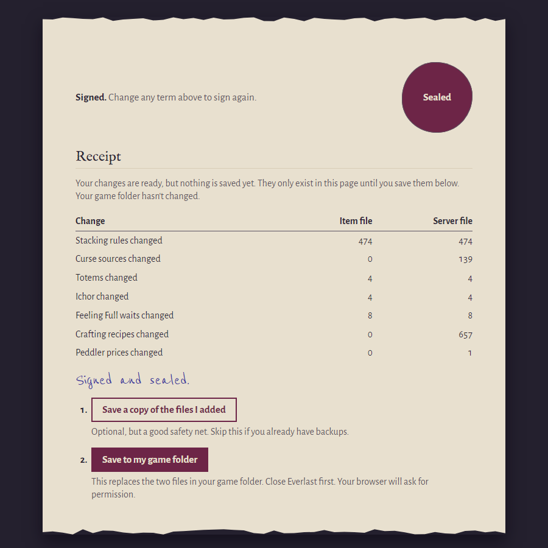
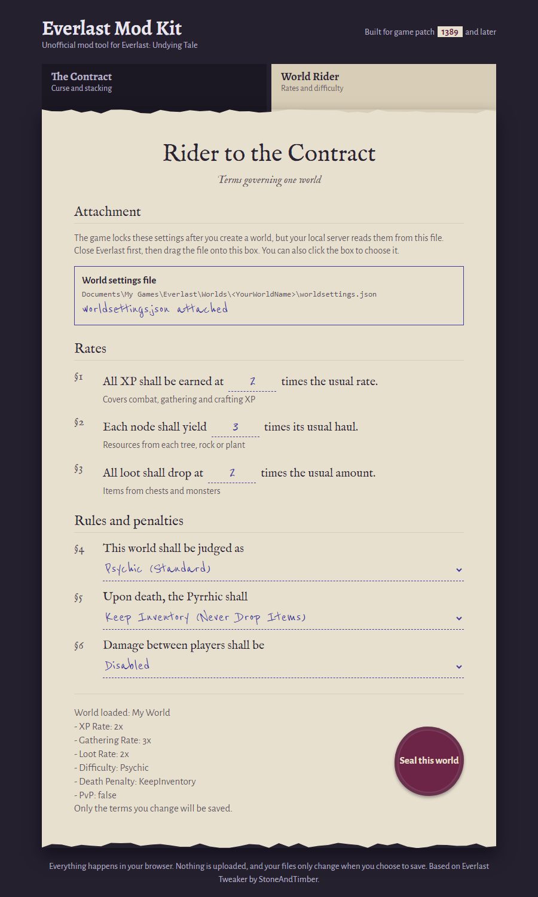

# Everlast Mod Kit

A free, no-install mod tool for **Everlast: Undying Tale**. It's a single web page that lets you remove curse sources, raise stack sizes and change your world's rates and difficulty.

There's nothing to install, and nothing is uploaded. Your files stay on your PC.

## What you can change

**The Contract** (curse and stacking)

- Remove curse from gathering, combat, picking up or stealing items, and crafting
- Make totems clear more curse
- Let meals, potions, moulds and unstrung bows stack
- Raise stack sizes for ores, bars, milk, logs and fish

**World Rider** (one world's settings)

- XP, gathering and loot rates
- Difficulty
- What happens to your items when you die
- Whether players can damage each other

## How to use it

1. **Download the page.** Right-click [Everlast Mod Kit.html](https://github.com/Hooch88/Everlast-Mod-Kit/raw/master/Everlast%20Mod%20Kit.html) and choose **Save link as**. A normal click only shows its code. Then double-click the saved file to open it. Chrome or Edge is recommended. You need to be online, because the page loads its database tool and fonts from the internet.
2. **Close Everlast**, including its local server.
3. **Add your game files.** In Steam, right-click Everlast and choose Manage, then Browse local files. Drag these two files onto their boxes on the page:
   - `Assets\Database\Definitions\ItemDefs.db`
   - `Everlast_Data\StreamingAssets\Server\Windows\Raptor.Data\Raptor.Game.db`
4. **Pick your changes.** The page shows what your files say now. Tick a term to strike it out, or untick one to put it back.
5. **Click Sign and seal**, then **Save to my game folder**. Your browser will ask for permission first. It's also worth clicking **Save a copy of the files I added** before you save.

If you don't see the save button, you'll get **Download my modded files** instead. Use that, then move both files into the game folders listed above, replacing the old ones.

### Changing a world

1. Open the **World Rider** tab.
2. Drag in your world's file from `Documents\My Games\Everlast\Worlds\<YourWorldName>\worldsettings.json`.
3. Change what you want, then click **Seal this world**.

## Undoing a change

Add your files to the page again, untick the term and save. You don't need a backup.

To put everything back exactly as the game shipped it, use Steam: right-click Everlast and choose Properties, then Installed Files, then Verify integrity of game files.

## Good to know

- This is an unofficial tool, made for solo and private worlds.
- Built for game patch 1389. A game update may replace these files, so come back and apply your changes again.
- Back up your Worlds folder and try your changes on a test world first.
- Saving directly needs Chrome or Edge. Other browsers use the download instead. Your browser may also refuse to save into a Steam library inside `Program Files`, and the download works there too.

## Credits

Based on Everlast Tweaker by StoneAndTimber. The stacking and totem changes build on that tool, and some of its code is still used here.
