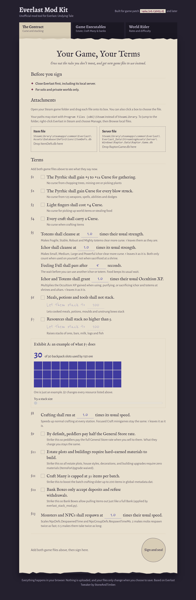
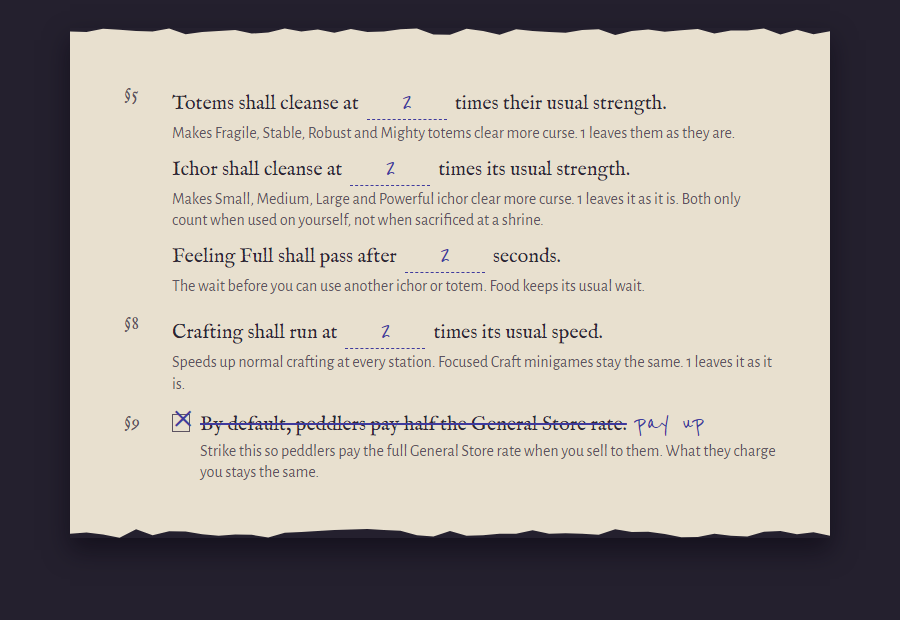

# Everlast Mod Kit

A free, all-in-one quality-of-life mod tool and patcher for **Everlast: Undying Tale**. Available both as a standalone no-install browser interface (`Everlast Mod Kit.html`) and an automated one-click Python patcher (`everlast_stack_mod.py`).

There's nothing to install, and nothing is uploaded. Your files stay on your PC.

### Key Features at a Glance

- **Truly Free Estate Building:** Removes all material requirements (`ItemsForUpgrade`) across all estate plots, house styles, and decor.
- **100 Estate Points & Progression Unlock:** Grants 100 available Estate Points and unlocks construction order across all floors (client UI & server authoritative checks).
- **Bank Box Withdrawals:** Pull and withdraw items directly from Bank Boxes (drag or left-click) just like a full Bank.
- **Craft Many Batch Limit (200 Max):** Raises the batch crafting slider ceiling from 30 up to 200 items in a single craft.
- **Custom Crafting Rarity Rates:** Set exact percentage chances for all 5 equipment quality tiers (Normal, Fine, Superior, Flawless, Masterwork) across normal crafts and minigames.
- **Adjustable Mob Spawn Timers:** Scale monster and pack respawn delays across all 509 NPCs (e.g., 2x faster respawns).
- **Complete Curse Removal:** Eliminate curses gained from gathering nodes, combat attacks/spells, stealing/looting world items, and crafting.
- **Item Stacking:** Expand resources (ores, bars, logs, fish) and non-stackables (cooked meals, potions, moulds, unstrung bows) to stacks of 100.
- **Faster Crafting:** Speed up regular crafting station timers without affecting Focused Craft minigames.
- **Fair Peddler Payouts:** Make roaming peddlers pay the full 100% General Store sell rate.
- **Totem & Ichor Buffs:** Boost cleansing values, shorten the Feeling Full delay, and multiply Occultism XP gained from altars and shrines.
- **World Rider Settings:** Edit world XP rates, gather rates, loot rates, difficulty, and death drop penalties for any existing world save.



## What you can change

**The Contract & Estate Upgrades**

- **Free Estate Building:** Build and upgrade estate plots, house styles, and decor without material requirements (`ItemsForUpgrade` waived).
- **Unlimited Estate Points & Progression:** Bypasses progression locks and provides 100 Estate Points so you can construct your full estate immediately.
- **Bank Box Withdrawals:** Allows pulling and withdrawing items out of Bank Boxes (drag or left-click) just like a full Bank.
- **Craft Many Batch Limit (200 Max):** Boosts the "Craft Many" slider ceiling up to 200 items in a single batch (vanilla slider capped at 30).
- **Mob Spawn & Respawn Timers:** Scale monster and pack respawn delays (e.g. 2x faster respawns).
- **Curse Removal:** Remove curse from gathering, combat, picking up or stealing items, and crafting.
- **Totem & Ichor Cleansing:** Make totems and ichor clear more curse, and shorten the Feeling Full wait after using them.
- **Progression & EXP Boosts:** 10x progression rewards on Desolate Zones & drop-offs, plus 3x sacrifice/purification EXP at altars and shrines.
- **Crafting Speed & Rarity Rates:** Speed up normal crafting timers and set exact percentage odds for equipment quality tiers (e.g. Masterwork, Flawless, Superior).
- **Fair Peddlers:** Make peddlers pay the full General Store rate when you sell to them.
- **Item Stacking:** Let meals, potions, moulds, unstrung bows, and resource items stack to 100.



**World Rider** (one world's settings)

- XP, gathering, and loot rates
- Difficulty
- What happens to your items when you die
- Whether players can damage each other

---

## How to use it

### Option A: Automated One-Click Patcher (Python)

1. Ensure Everlast is closed (or save and exit to menu).
2. Run `everlast_stack_mod.py` (or double click `PATCH_EVERLAST.bat`):
   ```powershell
   python everlast_stack_mod.py
   ```
3. All database definitions (`ItemDefs.db`, `ComponentSetDefs.db`, `EstatePlotDefs.db`, `Raptor.Game.db`), client metadata (`global-metadata.dat`), and client binary logic (`GameAssembly.dll`) are automatically backed up and patched!

### Option B: Web Tool (`Everlast Mod Kit.html`)

1. **Open the page:** Double-click `Everlast Mod Kit.html` in Chrome or Edge.
2. **Close Everlast**, including its local server.
3. **Add your game database files:** Drag these two files onto their boxes on the page:
   - `Assets\Database\Definitions\ItemDefs.db`
   - `Everlast_Data\StreamingAssets\Server\Windows\Raptor.Data\Raptor.Game.db`
4. **Pick your changes:** Tick a term to strike it out, or untick one to put it back.
5. **Click Sign and seal**, then **Save to my game folder** (saves database changes like stacking, curses, free materials, craft speeds, and mob respawns).
6. **(Optional / After Steam Updates) Patch Executables:**
   - **What it does:** Features like **100 Estate Points (§10)**, **Craft Many 200 (§11)**, and **Bank Box Withdrawals (§12)** are stored in compiled code files (`GameAssembly.dll`, `Raptor.Game.exe`, `global-metadata.dat`), not database tables.
   - **When to use:** Whenever Steam updates Everlast or verifies files, Steam resets those files to vanilla. Click the **"Patch Game Executables"** button on the receipt and select your main `Everlast` folder to instantly re-apply (or restore) code patches without needing Python.

---

## Technical Internals & Knowledge Map

For modders, developers, and technical details on schemas, exact byte offsets, IL2CPP method tokens, and binary patches, see:
- [`EVERLAST_INTERNALS_MAP.md`](EVERLAST_INTERNALS_MAP.md)

---

## Undoing a change

- **From Backup:** Backups are created automatically with `.original_bak` extensions next to patched binaries and databases, and inside `ModBackups\`.
- **Steam Verify:** In Steam, right-click Everlast and choose **Properties** -> **Installed Files** -> **Verify integrity of game files**.

---

## Good to know

- This is an unofficial tool, made for solo and private worlds.
- Compatible with game patch 1464 (v0.13005.0) and later.
- Back up your Worlds folder (`Documents\My Games\Everlast\Worlds`) before applying changes.

## Credits

Credit to StoneAndTimber for inspiration to flesh this mod out.
